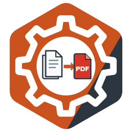

# docx-to-pdf

<!-- languages:begin -->
[English](README.md) · [Русский](README.ru.md) · [中文](README.zh-CN.md) · **Español**
<!-- languages:end -->
<!-- translation of README.md: 4ab3eca7c4d0 -->



**Documentación: [oxidestack.github.io/docx-to-pdf](https://oxidestack.github.io/docx-to-pdf/)**

> **docx-to-pdf convierte documentos de oficina a PDF más rápido y con menos memoria que Gotenberg y
> moalhaddar/docx-to-pdf con los mismos documentos, y ningún documento —por grande, malicioso o dañado que sea—
> puede tumbarlo, retenerlo más allá de su tiempo límite ni hacer que acceda a la red.**

Cada cifra de esta comparación, las condiciones de medición y los resultados en bruto están en la página
[Benchmarks](https://oxidestack.github.io/docx-to-pdf/benchmarks/).

Un servicio HTTP que convierte un documento de oficina en un PDF con LibreOffice.

Responde a las mismas peticiones que [moalhaddar/docx-to-pdf](https://github.com/moalhaddar/docx-to-pdf)
2.1.0-13, de modo que un cliente de ese servicio pasa a este sin cambiar una línea, y está hecho para aguantar una
carga que aquel servicio no resiste: un documento cuya conversión nunca termina, una petición cuya subida nunca
termina, un archivo que no es un documento, una ráfaga de más peticiones que procesos de LibreOffice. Está escrito
en Rust, incluye un LibreOffice actual e informa de lo que hace mediante OpenTelemetry.

## Inicio rápido

```sh
docker run --rm -p 8080:8080 quay.io/oxidestack/docx-to-pdf:1.2.0
```

En otra terminal, una vez que haya arrancado:

```sh
curl -F document=@report.docx http://localhost:8080/pdf -o report.pdf
```

`report.pdf` es el documento tal como lo maqueta LibreOffice. Una prueba repite este `curl` contra el servicio.

Cada versión está firmada e incluye su SBOM y la procedencia de su compilación;
[Verificar una versión](docs/i18n/es/guide/installation.md#verificar-una-versión) explica cómo comprobar una imagen
o un chart con `cosign` y `gh attestation verify`.

## Qué ofrece

- **Entra Word y texto OpenDocument, sale PDF**: DOCX, DOCM, DOTX, DOC, ODT, OTT, ODT plano y RTF. El formato se
  decide por los bytes del documento, no por su nombre; cualquier otra cosa se rechaza con `415` antes de que empiece
  ninguna conversión.
- **La interfaz de moalhaddar/docx-to-pdf**: `POST /pdf` y `POST /docx-to-pdf`, el documento en una parte de archivo
  multipart llamada `document` y el PDF como respuesta.
- **Fiabilidad**: un límite de tiempo en cada conversión, una espera acotada por un proceso de LibreOffice libre,
  límites al tamaño de un documento y a lo que ocupa al descomprimirse, procesos de LibreOffice reemplazados cuando
  fallan, se cuelgan o han hecho un número fijado de conversiones, y una parada ordenada que termina las
  conversiones en curso. Cada error es un documento de problema [RFC 9457](https://www.rfc-editor.org/rfc/rfc9457)
  con un estado que dice qué salió mal.
- **Telemetría**: trazas, logs y métricas por OTLP, métricas de Prometheus en `/metrics` y las comprobaciones de
  salud `/livez` y `/readyz` para Kubernetes.
- **Un contenedor blindado** para `linux/amd64` y `linux/arm64`: un usuario que no es root, un sistema de archivos
  raíz de solo lectura, ninguna capability de Linux y solo fuentes libres: métricamente compatibles con las fuentes
  habituales de Microsoft y con cobertura de chino, japonés y coreano (Noto CJK), de modo que un documento CJK se
  convierte sin fuentes propias.

## Documentación

La guía está publicada en [oxidestack.github.io/docx-to-pdf](https://oxidestack.github.io/docx-to-pdf/): la última
versión en la raíz y cada versión bajo su número. Las mismas páginas, tal como están en `main`, se encuentran en
`docs/guide/` (en inglés) y en `docs/i18n/es/` (traducidas):

- [Instalación](docs/i18n/es/guide/installation.md) — `docker run`, Docker Compose y Kubernetes con el chart de Helm, y
  los recursos que darle
- [Actualización](docs/i18n/es/guide/upgrading.md) — qué pide cada versión a un despliegue y cómo pasar a una más nueva
- [Configuración](docs/i18n/es/guide/configuration.md) — cada variable de entorno, su valor por defecto y su efecto
- [Referencia de la API](docs/i18n/es/guide/api.md) — los endpoints, los formatos aceptados, cada estado y su detalle
- [Operaciones](docs/i18n/es/guide/operations.md) — el contenedor, las comprobaciones de salud, Kubernetes, la
  telemetría y las métricas, los límites, el dimensionamiento y las fuentes
- [Solución de problemas](docs/i18n/es/guide/troubleshooting.md) — cada respuesta de error y otros problemas, qué
  significa cada uno y qué hacer
- [Migrar desde moalhaddar/docx-to-pdf](docs/i18n/es/guide/migration.md) — qué sigue igual, qué cambia un cliente o un
  despliegue, y cada diferencia deliberada
- [Changelog](CHANGELOG.md) — qué cambió cada versión y qué tiene que hacer un operador cuando una versión
  lo pide
- [Comparación con Gotenberg y moalhaddar/docx-to-pdf](docs/i18n/es/guide/comparison.md) — qué hace cada uno,
  velocidad, memoria y documentos hostiles según las mediciones registradas, y los comandos que las repiten

## Compilación y pruebas

El repositorio incluye moalhaddar/docx-to-pdf como submódulo de git, que leen las pruebas, así que clónelo con sus
submódulos:

```sh
git clone --recursive https://github.com/oxidestack/docx-to-pdf.git
```

En un clon hecho sin `--recursive`, ejecute `git submodule update --init` una vez.

- `make image` compila la imagen del contenedor para la arquitectura de su máquina como `docx-to-pdf:dev`.
- `make check` ejecuta el formato, clippy y las pruebas de la biblioteca. `cargo test` ejecuta todas las pruebas;
  necesita una toolchain de Rust y poppler en el `PATH` (`pdfinfo`, `pdftotext`, `pdftoppm`: `brew install poppler`
  en macOS, `apt-get install poppler-utils` en Debian), y las pruebas que convierten documentos reales necesitan
  LibreOffice. `tools/instance-test/run.sh` las ejecuta en un contenedor Linux que lleva los tres.
- `make lint` ejecuta todas las comprobaciones de calidad que ejecuta la CI, cada una en su propio contenedor fijado;
  la sección [checks](CONTRIBUTING.md#the-checks) de CONTRIBUTING.md las enumera, y la insignia de CI
  muestra su estado en `main`.

## Ayuda

Una pregunta sobre cómo funciona el servicio puede ir primero a
[DeepWiki](https://deepwiki.com/oxidestack/docx-to-pdf): responde a partir del código y la documentación de este
repositorio, y cuando no coincide con la documentación, la documentación tiene razón. Las preguntas que no resuelva
van a [Discussions](https://github.com/oxidestack/docx-to-pdf/discussions), los errores a
[issues](https://github.com/oxidestack/docx-to-pdf/issues/new/choose) y las vulnerabilidades a un informe privado
([SECURITY.md](SECURITY.md)). [CONTRIBUTING.md](CONTRIBUTING.md) explica cómo compilar, probar y
enviar un cambio.

## Licencia

El código se distribuye bajo la [Apache License, Version 2.0](LICENSE) (`Apache-2.0`). La documentación
—el README, las guías de `docs/` y el README del chart— se distribuye bajo
[Creative Commons Attribution 4.0 International](https://creativecommons.org/licenses/by/4.0/) (`CC-BY-4.0`). El
material tomado de moalhaddar/docx-to-pdf, las fuentes y LibreOffice conservan sus propias licencias y se atribuyen
en [`NOTICE`](NOTICE).
