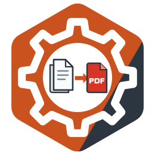

# docx-to-pdf

<!-- languages:begin -->
[English](README.md) · **Русский** · [中文](README.zh-CN.md) · [Español](README.es.md)
<!-- languages:end -->
<!-- translation of README.md: 4ab3eca7c4d0 -->



**Документация: [oxidestack.github.io/docx-to-pdf](https://oxidestack.github.io/docx-to-pdf/)**

> **docx-to-pdf превращает офисные документы в PDF быстрее и с меньшим расходом памяти, чем Gotenberg и
> moalhaddar/docx-to-pdf на тех же документах, и ни один документ — сколь угодно большой, вредоносный или
> повреждённый — не может его уронить, задержать дольше его тайм-аута или заставить обратиться в сеть.**

Каждая цифра этого сравнения, условия замеров и сырые результаты — на странице
[Benchmarks](https://oxidestack.github.io/docx-to-pdf/benchmarks/).

HTTP-сервис, который превращает офисный документ в PDF с помощью LibreOffice.

Он отвечает на те же запросы, что и [moalhaddar/docx-to-pdf](https://github.com/moalhaddar/docx-to-pdf) 2.1.0-13,
поэтому клиент того сервиса переходит на этот, не меняя ни строчки, и он построен так, чтобы выдерживать нагрузку,
которую тот сервис не переживает: документ, конвертация которого никогда не заканчивается, запрос, загрузка
которого никогда не заканчивается, файл, который не является документом, всплеск запросов больше, чем процессов
LibreOffice. Он написан на Rust, поставляется с актуальным LibreOffice и сообщает о своей работе через
OpenTelemetry.

## Быстрый старт

```sh
docker run --rm -p 8080:8080 quay.io/oxidestack/docx-to-pdf:1.2.0
```

В другом терминале, когда сервис запустится:

```sh
curl -F document=@report.docx http://localhost:8080/pdf -o report.pdf
```

`report.pdf` — документ в той вёрстке, которую дал LibreOffice. Тест повторяет этот `curl` против сервиса.

Каждый релиз подписан и несёт свой SBOM и сведения о сборке;
[Verifying a release](docs/guide/installation.md#verifying-a-release) показывает, как проверить образ или чарт с
помощью `cosign` и `gh attestation verify`.

## Что он даёт

- **На входе Word и текстовые документы OpenDocument, на выходе PDF**: DOCX, DOCM, DOTX, DOC, ODT, OTT, плоский
  ODT и RTF. Формат определяется по байтам документа, а не по его имени; всё остальное отклоняется с `415` до начала
  любой конвертации.
- **Интерфейс moalhaddar/docx-to-pdf**: `POST /pdf` и `POST /docx-to-pdf`, документ в части multipart с именем
  `document`, PDF в ответе.
- **Надёжность**: ограничение времени на каждую конвертацию, ограниченное ожидание свободного процесса LibreOffice,
  ограничения на размер документа и на то, во что он распаковывается, замена процессов LibreOffice, которые упали,
  зависли или выполнили заданное число конвертаций, и плавная остановка, которая доводит до конца начатые
  конвертации. Каждая ошибка — документ [RFC 9457](https://www.rfc-editor.org/rfc/rfc9457) со статусом, который
  говорит, что пошло не так.
- **Телеметрия**: трассы, логи и метрики по OTLP, метрики Prometheus на `/metrics` и проверки здоровья `/livez` и
  `/readyz` для Kubernetes.
- **Закрытый контейнер** для `linux/amd64` и `linux/arm64`: пользователь не root, корневая файловая система только для
  чтения, без capabilities Linux и только свободные шрифты: метрически совместимые с распространёнными шрифтами
  Microsoft и покрывающие китайский, японский и корейский (Noto CJK), так что документ на этих языках
  конвертируется без собственных шрифтов.

## Документация

Руководство опубликовано на [oxidestack.github.io/docx-to-pdf](https://oxidestack.github.io/docx-to-pdf/):
последний релиз в корне, каждый релиз под своей версией. Те же страницы в том виде, в каком они в `main`, лежат в
`docs/guide/` (по-английски) и в `docs/i18n/ru/` (переведённые):

- [Installation](docs/guide/installation.md) — `docker run`, Docker Compose и Kubernetes с чартом Helm, и
  какие ресурсы ему дать
- [Обновление](docs/i18n/ru/guide/upgrading.md) — что каждый релиз требует от развёртывания и как перейти на более новый
- [Configuration](docs/guide/configuration.md) — каждая переменная окружения, её значение по умолчанию и действие
- [API reference](docs/guide/api.md) — эндпоинты, принимаемые форматы, каждый статус и его подробности
- [Operations](docs/guide/operations.md) — контейнер, проверки здоровья, Kubernetes, телеметрия и метрики,
  ограничения, расчёт ресурсов и шрифты
- [Troubleshooting](docs/guide/troubleshooting.md) — каждый ответ с ошибкой и другие проблемы: что каждая значит и
  что делать
- [Migrating from moalhaddar/docx-to-pdf](docs/guide/migration.md) — что остаётся тем же, что меняет клиент или
  развёртывание, и каждое намеренное отличие
- [Changelog](CHANGELOG.md) — что изменил каждый релиз и что должен сделать оператор, когда релиз этого
  требует
- [Compared with Gotenberg and moalhaddar/docx-to-pdf](docs/guide/comparison.md) — что делает каждый, скорость,
  память и враждебные документы по записанным замерам, и команды, которые их повторяют

## Сборка и тесты

Репозиторий содержит moalhaddar/docx-to-pdf как подмодуль git, который читают тесты, поэтому клонируйте его вместе
с подмодулями:

```sh
git clone --recursive https://github.com/oxidestack/docx-to-pdf.git
```

В клоне, сделанном без `--recursive`, один раз выполните `git submodule update --init`.

- `make image` собирает образ контейнера для архитектуры вашей машины как `docx-to-pdf:dev`.
- `make check` запускает форматирование, clippy и тесты библиотеки. `cargo test` запускает все тесты; ему нужны
  инструменты Rust и poppler в `PATH` (`pdfinfo`, `pdftotext`, `pdftoppm`: `brew install poppler` на macOS,
  `apt-get install poppler-utils` на Debian), а тестам, которые конвертируют настоящие документы, нужен
  LibreOffice. `tools/instance-test/run.sh` запускает их в контейнере Linux, где есть все три.
- `make lint` запускает все проверки качества, которые запускает CI, каждую в своём закреплённом контейнере; их
  перечисляет раздел [checks](CONTRIBUTING.md#the-checks) в CONTRIBUTING.md, а значок CI отражает их
  состояние в `main`.

## Помощь

Вопрос о том, как устроен сервис, можно сначала задать [DeepWiki](https://deepwiki.com/oxidestack/docx-to-pdf):
он отвечает по коду и документации этого репозитория, а там, где он расходится с документацией, права
документация. Вопросы, которые он не решил, — в
[Discussions](https://github.com/oxidestack/docx-to-pdf/discussions), ошибки — в
[issues](https://github.com/oxidestack/docx-to-pdf/issues/new/choose), уязвимости — в закрытом сообщении
([SECURITY.md](SECURITY.md)). [CONTRIBUTING.md](CONTRIBUTING.md) объясняет, как собрать,
протестировать и прислать изменение.

## Лицензия

Код распространяется по лицензии [Apache License, Version 2.0](LICENSE) (`Apache-2.0`). Документация —
README, руководства в `docs/` и README чарта — по лицензии
[Creative Commons Attribution 4.0 International](https://creativecommons.org/licenses/by/4.0/) (`CC-BY-4.0`).
Материалы, взятые из moalhaddar/docx-to-pdf, шрифты и LibreOffice сохраняют свои лицензии и указаны в
[`NOTICE`](NOTICE).
