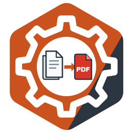

# docx-to-pdf

<!-- languages:begin -->
[English](README.md) · [Русский](README.ru.md) · **中文** · [Español](README.es.md)
<!-- languages:end -->
<!-- translation of README.md: 8bef85f82b32 -->



**文档：[oxidestack.github.io/docx-to-pdf](https://oxidestack.github.io/docx-to-pdf/)**

> **在相同的文档上，docx-to-pdf 将办公文档转换为 PDF 的速度比 Gotenberg 和 moalhaddar/docx-to-pdf
> 更快，占用的内存更少；而且任何文档——无论多大、多么恶意或多么残缺——都无法让它崩溃、
> 让它超出超时时间，或让它访问网络。**

这项比较的每一个数字、测量条件和原始结果，都在
[Benchmarks](https://oxidestack.github.io/docx-to-pdf/benchmarks/) 页面上。

一个用 LibreOffice 将办公文档转换为 PDF 的 HTTP 服务。

它与 [moalhaddar/docx-to-pdf](https://github.com/moalhaddar/docx-to-pdf) 2.1.0-13 响应相同的请求，
因此该服务的客户端无需修改一行代码即可迁移到本服务；它还能承受那个服务承受不住的负载：
永远转换不完的文档、永远上传不完的请求、不是文档的文件、超过 LibreOffice 进程数的突发请求。
它用 Rust 编写，附带最新的 LibreOffice，并通过 OpenTelemetry 报告自己的运行情况。

## 快速开始

```sh
docker run --rm -p 8080:8080 quay.io/oxidestack/docx-to-pdf:1.2.2
```

启动后，在另一个终端中：

```sh
curl -F document=@report.docx http://localhost:8080/pdf -o report.pdf
```

`report.pdf` 就是 LibreOffice 排版后的文档。有一个测试会对服务重放这条 `curl`。

每个版本都经过签名，并附带 SBOM 和构建来源证明；
[验证版本](docs/i18n/zh/guide/installation.md#验证版本)说明如何用 `cosign` 和
`gh attestation verify` 检查镜像或 chart。

## 它提供什么

- **输入 Word 和 OpenDocument 文本，输出 PDF**：DOCX、DOCM、DOTX、DOC、ODT、OTT、扁平 ODT 和 RTF。
  格式由文档的字节决定，而不是文件名；其他任何内容都会在转换开始前以 `415` 拒绝。
- **moalhaddar/docx-to-pdf 的接口**：`POST /pdf` 和 `POST /docx-to-pdf`，文档放在名为 `document`
  的 multipart 文件部分中，响应即为 PDF。
- **可靠性**：每次转换都有时间限制，等待空闲 LibreOffice 进程的时间有上限，文档大小及其解压后的大小有限制，
  崩溃、挂起或已完成设定次数转换的 LibreOffice 进程会被替换，优雅停机会完成正在进行的转换。
  每个错误都是一份 [RFC 9457](https://www.rfc-editor.org/rfc/rfc9457) problem 文档，其状态码说明了出错的原因。
- **遥测**：通过 OTLP 输出 trace、日志和指标，在 `/metrics` 提供 Prometheus 指标，并为 Kubernetes
  提供健康检查 `/livez` 和 `/readyz`。
- **加固的容器**，支持 `linux/amd64` 和 `linux/arm64`：非 root 用户、只读根文件系统、没有 Linux
  capabilities，且只带自由字体：与常见的 Microsoft 字体度量兼容，并覆盖中文、日文和韩文（Noto CJK），
  因此中日韩文档无需自备字体即可转换。

## 文档

指南发布在 [oxidestack.github.io/docx-to-pdf](https://oxidestack.github.io/docx-to-pdf/)：
根路径是最新版本，每个版本都在各自的版本号下。与 `main` 上一致的同一批页面位于 `docs/guide/`（英文）
和 `docs/i18n/zh/`（已翻译）：

- [安装](docs/i18n/zh/guide/installation.md)——`docker run`、Docker Compose，以及使用 Helm chart
  的 Kubernetes，还有需要分配的资源
- [升级](docs/i18n/zh/guide/upgrading.md)——每个版本对部署有什么要求，以及如何迁移到更新的版本
- [配置](docs/i18n/zh/guide/configuration.md)——每个环境变量、其默认值和作用
- [API 参考](docs/i18n/zh/guide/api.md)——端点、接受的格式、每个状态码及其详情
- [运维](docs/i18n/zh/guide/operations.md)——容器、健康检查、Kubernetes、遥测与指标、限制、容量规划和字体
- [故障排查](docs/i18n/zh/guide/troubleshooting.md)——每种错误响应和其他问题，各自的含义以及如何处理
- [从 moalhaddar/docx-to-pdf 迁移](docs/i18n/zh/guide/migration.md)——哪些保持不变，客户端或部署需要改什么，
  以及每一处有意的差异
- [Changelog](CHANGELOG.md)——每个版本改了什么，以及版本要求运维人员做什么
- [与 Gotenberg 和 moalhaddar/docx-to-pdf 的比较](docs/i18n/zh/guide/comparison.md)——各自能做什么，
  基于已记录测量的速度、内存和恶意文档表现，以及重复这些测量的命令

## 构建与测试

仓库以 git 子模块的形式包含 moalhaddar/docx-to-pdf，测试会读取它，因此请连同子模块一起克隆：

```sh
git clone --recursive https://github.com/oxidestack/docx-to-pdf.git
```

如果克隆时没有使用 `--recursive`，请运行一次 `git submodule update --init`。

- `make image` 为你机器的架构构建容器镜像 `docx-to-pdf:dev`。
- `make check` 运行格式检查、clippy 和库测试。`cargo test` 运行所有测试；它需要 Rust 工具链和
  `PATH` 中的 poppler（`pdfinfo`、`pdftotext`、`pdftoppm`：macOS 上 `brew install poppler`，
  Debian 上 `apt-get install poppler-utils`），转换真实文档的测试还需要 LibreOffice。
  `tools/instance-test/run.sh` 在一个包含这三者的 Linux 容器中运行它们。
- `make lint` 运行 CI 所运行的全部质量检查，每项都在各自固定版本的容器中；CONTRIBUTING.md 的
  [checks](CONTRIBUTING.md#the-checks) 列出了它们，CI 徽章显示它们在 `main` 上的状态。

## 获取帮助

关于服务如何工作的问题，可以先问 [DeepWiki](https://deepwiki.com/oxidestack/docx-to-pdf)：
它根据本仓库的代码和文档作答；当它与文档不一致时，以文档为准。它解决不了的问题请到 [Discussions](https://github.com/oxidestack/docx-to-pdf/discussions)，缺陷请提
[issues](https://github.com/oxidestack/docx-to-pdf/issues/new/choose)，漏洞请私下报告
（[SECURITY.md](SECURITY.md)）。[CONTRIBUTING.md](CONTRIBUTING.md)
说明如何构建、测试和提交修改。

## 许可证

代码采用 [Apache License, Version 2.0](LICENSE)（`Apache-2.0`）许可。文档——README、`docs/`
下的指南和 chart 的 README——采用
[Creative Commons Attribution 4.0 International](https://creativecommons.org/licenses/by/4.0/)（`CC-BY-4.0`）许可。
取自 moalhaddar/docx-to-pdf 的材料、字体和 LibreOffice 保留各自的许可证，并在
[`NOTICE`](NOTICE) 中注明。
